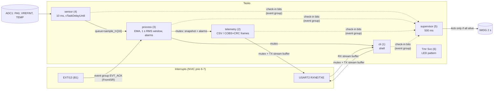

# Architecture

## Data flow



## Task set and timing budget

| Task | Prio | T (period) | C budget | B (blocking) | Stack | Monitored |
|---|---|---|---|---|---|---|
| Tmr Svc | 6 | 100 ms | 20 µs | 0 | 256 w | no (kernel) |
| supervisor | 5 | 500 ms | 300 µs | 0 | 512 w | no (it is the monitor) |
| sensor | 4 | 10 ms | 150 µs | 0 | 256 w | yes |
| process | 3 | 10 ms | 150 µs | 50 µs | 512 w | yes |
| telemetry | 2 | 100 ms | 1 000 µs | 10 ms | 512 w | yes |
| cli | 1 | ≥ 50 ms | 5 000 µs | 0 | 768 w | yes |

Priorities are rate-monotonic. The supervisor is the only exception: it sits
above the workers so a runaway worker cannot starve the thing that is meant
to detect it.

At boot (and with `rta` / `rta measured`) the firmware runs exact
response-time analysis on this table:

```
R_i = B_i + C_i + Σ_{j ∈ hp(i)} ⌈R_i / T_j⌉ · C_j
```

`rta measured` swaps each budget for the worst execution time actually
measured with TIM2 (1 µs) whenever the measurement is larger. A budget that
was too optimistic therefore shows up as an analysis failure, not as a
silent deadline miss in the field.

Blocking terms:
- **process, B = 50 µs**: the longest critical section on the state mutex
  (copying a 16-byte snapshot or updating three alarms).
- **telemetry, B = 10 ms**: worst wait for the UART TX mutex while the CLI
  prints a long reply into a nearly full 1 KiB TX buffer. At 115 200 baud the
  buffer drains at about 11.5 bytes/ms.

Priority inheritance on both mutexes keeps these bounds valid: a low-priority
holder runs at the waiter's priority until it releases the lock, so medium
priority work cannot extend the blocking (no unbounded priority inversion).

## Memory

- **No heap.** `configSUPPORT_DYNAMIC_ALLOCATION = 0`. Every task, queue,
  mutex, event group, stream buffer and timer is created with the `Static`
  API, so the linker map is the complete RAM budget.
- Flash 30 KB of 512 KB, RAM 18 KB of 96 KB (NUCLEO build, `-Os`).
- `-fstack-usage` reports the deepest static frame in app code (`cmd_selftest`,
  296 B), and CI prints the top frames on every build. At runtime, `ps`
  shows each task's stack high-water mark, and stack-overflow checking
  method 2 (canary pattern) is enabled.

## Interrupt design

| IRQ | NVIC prio | Work done in the ISR | Deferred to |
|---|---|---|---|
| USART2 | 6 | move one byte to or from a stream buffer | cli task / stream buffer |
| EXTI15_10 | 7 | clear flag, 50 ms time-based debounce, set an event bit | process task |
| SysTick, PendSV | 15 | kernel | n/a |

ISRs never format, allocate or block. Priorities 0–4 are left free for
future hard real-time interrupts, which the kernel never masks
(`configMAX_SYSCALL_INTERRUPT_PRIORITY = 5`).

## Fault handling and recovery

| Fault | Detection | Action |
|---|---|---|
| HardFault / BusFault / UsageFault / MemManage | naked handler picks MSP or PSP and captures the stacked PC, LR and xPSR plus CFSR, HFSR, MMFAR and BFAR | record → print → reset |
| `configASSERT` | kernel and app asserts | record file:line → print → reset |
| Stack overflow | canary check (method 2) on every context switch | record task name → print → reset |
| Task stall or deadlock | missing check-in for more than 2 supervision windows | record culprit → stop feeding IWDG → hardware reset |
| PLL fails to lock | bounded waits in clock init | continue on HSI 16 MHz, reported in `status` |
| ADC conversion hangs | 200 µs timeout | sample dropped, counted in `stats` |

Records live in a `.noinit` section protected by a CRC, so they survive the
reset and are printed on the next boot. `crash <hardfault|assert|stack|stall>`
injects each failure on purpose to prove the recovery path end to end.

## Telemetry wire format

See `lib/include/telemetry.h`: a 24-byte little-endian frame plus
CRC-16/CCITT-FALSE, COBS-encoded and terminated by `0x00`. COBS keeps
framing unambiguous on a byte stream, so a receiver resynchronises at the
next zero after any corruption, and the CRC rejects the damaged frame.
`tools/tlm_decode.py` decodes frames while passing CLI text through
unchanged. A shared golden vector, checked in both the C and the Python
test suites, keeps the two implementations from drifting apart.
